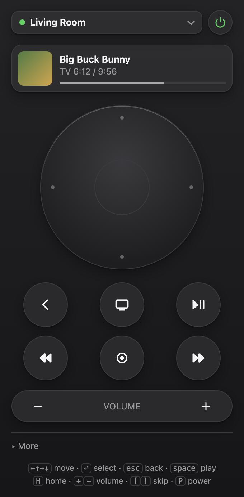

# atv-remote

[](https://github.com/ijdio/atv-remote/actions/workflows/ci.yml)
[](LICENSE)


**Control your Apple TV from your Mac.** A menu bar item with quick controls, a
floating native remote you can drive from the keyboard, and the same remote as a
local web page. Built on [pyatv](https://pyatv.dev).



## Features

- **Menu bar:** see what's playing; play/pause, skip, volume, home, back and power;
  switch between Apple TVs
- **Remote panel** (⌘R from the menu): a Siri Remote–style clickpad (click the
  edges, drag to swipe, two-finger trackpad swipes, hold for the context menu)
- **Keyboard control:** arrows, Return, Esc, Space and more (see below)
- **Now playing** with artwork and progress, pushed live from the Apple TV
- **Launch apps** and **type into search fields** from your Mac
- **Several Apple TVs:** pick one from the menu; the last one used is remembered
- **Pairing built in:** enter the on-screen PINs in the panel, no terminal needed
- **Start at login**, with automatic restart if it crashes

## Requirements

- macOS (developed and tested on macOS 26, Apple Silicon)
- An Apple TV on the same network (tested with Apple TV 4K on tvOS 26 and 27)
- [uv](https://docs.astral.sh/uv/). It installs Python 3.13 for you if needed.

## Install

```sh
git clone https://github.com/ijdio/atv-remote.git
cd atv-remote
uv sync
uv run atv-remote
```

Or install it as a command without cloning:

```sh
uv tool install git+https://github.com/ijdio/atv-remote
atv-remote
```

A TV icon appears in the menu bar. There's no Dock icon.

## Pair your Apple TV

1. Click the menu bar icon → **Apple TV** → pick your TV. The remote panel opens.
2. Press **Start pairing**. The TV shows a 4-digit PIN; type it into the panel.
3. A second PIN appears. Type that one too.

The first PIN (AirPlay) unlocks now-playing info and artwork. The second
(Companion) unlocks the remote buttons, power, apps and text input. Pairing is
stored in `~/.pyatv.conf`, the same file pyatv's own `atvremote` tool uses.

## Start at login

```sh
scripts/login-item.sh install     # installs a LaunchAgent and starts it now
scripts/login-item.sh uninstall
```

The agent restarts the app if it crashes, but not after you choose **Quit**.
Logs go to `~/Library/Logs/atv-remote.log`. After changing the code, restart it
with `launchctl kickstart -k gui/$(id -u)/local.atv-remote`.

## Keyboard shortcuts

In the remote panel (or the web page):

| Key | Action | Key | Action |
|---|---|---|---|
| ← ↑ → ↓ | Move | H | Home |
| Return | Select | + / − | Volume |
| Esc / Delete | Back | [ / ] | Skip back / forward |
| Space | Play / pause | P | Power |

Hold the Home button for Control Centre, or the clickpad centre for the context menu.

## Web remote and headless mode

The panel is a web page served at <http://127.0.0.1:48765/>, which you can also
open in a browser. To run only the server, with no menu bar item, use
`uv run atv-remote-web`. Set `ATV_REMOTE_PORT` to change the port.

The server listens on 127.0.0.1 only. It rejects requests with an unexpected
`Host` header (DNS rebinding) and button presses without the custom
`X-ATV-Remote` header, so other websites can't drive your TV.

## Troubleshooting

- **No Apple TV found:** the Mac and the Apple TV must be on the same network
  and subnet, and mDNS (Bonjour) must not be blocked by the router or a VPN.
  Try **Rescan** in the menu.
- **Pairing fails or no PIN appears:** on the Apple TV, check
  *Settings → AirPlay and HomeKit → Allow Access* and make sure it lets your Mac
  connect, and that the TV is awake when you start pairing.
- **Pairing fails with an `SRPClientSession` error:** `srptools` 2.x is
  installed. This project pins `srptools<2` because pyatv 0.18.0 isn't compatible
  with it yet. Run `uv sync` to get the pinned version.
- **Buttons work but there's no now-playing info:** the AirPlay half of pairing
  is missing. Pair again from the panel.
- **Something else:** check `~/Library/Logs/atv-remote.log` (login item) or the
  terminal output, then [open an issue](https://github.com/ijdio/atv-remote/issues).

## How it works

```
menu bar (rumps, main thread) ──┐
remote panel (NSPanel + WKWebView) ──► http://127.0.0.1:48765 (aiohttp)
                                        │
                              Controller (asyncio thread)
                                        │ pyatv
                                    Apple TV (AirPlay + Companion)
```

| File | Role |
|---|---|
| `src/atv_remote/core.py` | `Controller`: scanning, pairing, connection and reconnects, commands, push updates |
| `src/atv_remote/web.py` | HTTP API and request guards |
| `src/atv_remote/menubar.py` | Menu bar item and the native floating panel |
| `src/atv_remote/static/index.html` | The remote UI (no build step) |
| `scripts/login-item.sh` | LaunchAgent install/uninstall |

## Development

```sh
uv sync
uv run pytest
uv run ruff check . && uv run ruff format --check .
```

Issues and pull requests are welcome. See [CONTRIBUTING.md](CONTRIBUTING.md), and
report security problems privately as described in [SECURITY.md](SECURITY.md).

## Credits

Built on [pyatv](https://github.com/postlund/pyatv) by Pierre Ståhl and
[rumps](https://github.com/jaredks/rumps). MIT licensed; see [LICENSE](LICENSE).

Not affiliated with or endorsed by Apple. Apple TV and tvOS are trademarks of
Apple Inc.
